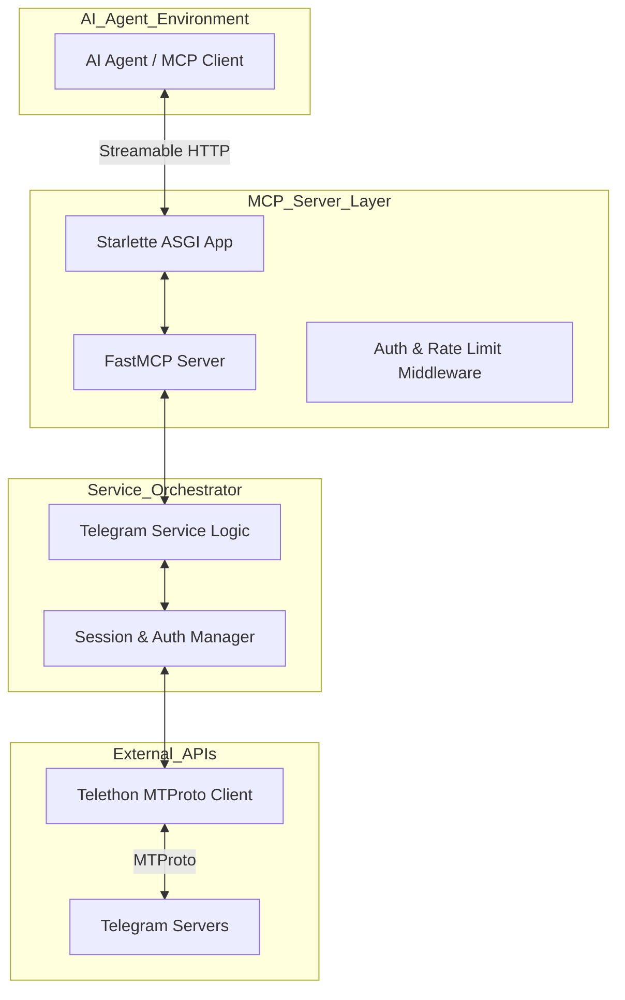
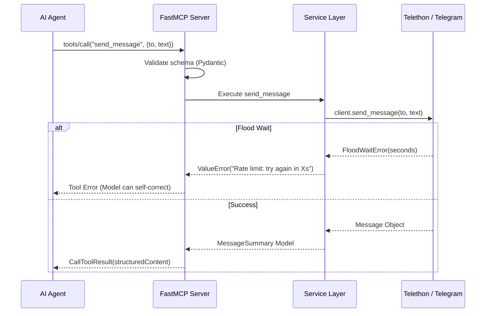

# Telegram MCP Server Architecture

## 1. Overview
This project implements a **Model Context Protocol (MCP)** server that exposes Telegram's capabilities to AI agents. It leverages the official Python MCP SDK for the server implementation and **Telethon** for high-performance MTProto communication with Telegram's servers.

The architecture is designed to be secure, stateless (at the transport level), and resilient, following 2026 production standards.

## 2. System Architecture

The system is organized into a layered architecture to separate protocol handling, business logic, and external communication.

### 2.1 Core Components

*   **MCP Server (FastMCP):** Handles the JSON-RPC 2.0 protocol, managing the initialization lifecycle, and exposing Tools, Resources, and Prompts.
*   **Starlette ASGI Shell:** Provides a production-ready HTTP/SSE transport layer. It handles TLS termination (via ingress), health checks, and authentication middleware.
*   **Telethon Client:** Manages the MTProto connection to Telegram. It handles encryption, session persistence (SQLite), and provides friendly APIs for Telegram interactions.
*   **Service Orchestrator:** The glue code that translates MCP tool calls (e.g., `send_message`) into Telethon actions. It maps Telethon exceptions (like `FloodWaitError`) to meaningful MCP error responses.

## 3. Data Flow & Lifecycle

### 3.1 Connection Lifecycle
1.  **Initialize:** The AI Agent sends an `initialize` request. The server responds with capabilities (tools like `list_contacts`, `send_message`, `read_history`).
2.  **Authenticated Request:** Each MCP tool call is validated via Pydantic at the boundary.
3.  **Domain Execution:** The Service Orchestrator ensures the Telethon client is connected and authorized.
4.  **Telegram Interaction:** Telethon performs the MTProto call.
5.  **Result Mapping:** The result is wrapped in a structured Pydantic model and returned to the agent.

### 3.2 Sequence Diagram: Sending a Message

## 4. Security & Authentication

### 4.1 MCP Transport Security
*   **Streamable HTTP:** Uses standard OAuth 2.1/JWT verification for remote deployments.
*   **Statelessness:** The MCP server itself is stateless; all Telegram-specific state is managed by Telethon session files.

### 4.2 Telegram Security
*   **API Credentials:** `API_ID` and `API_HASH` are stored as environment variables.
*   **Session Management:** Uses `SQLiteSession` files. Each deployment instance/account MUST use a unique session file.
*   **Credential Protection:** Session files and `StringSession` strings are treated as secrets and NEVER committed to source control.

## 5. Resilience & Performance

*   **Flood Handling:** The server catches `FloodWaitError` and returns it as a tool error, allowing the AI agent to understand the rate limit and potentially wait or retry later.
*   **Concurrency:** One event loop handles both the MCP server and the Telethon client. Updates from Telegram are handled as tasks to avoid blocking.
*   **Performance:** `cryptg` is used to accelerate MTProto encryption/decryption, ensuring high throughput for media and large message batches.

## 6. Technical Stack

| Layer | Technology |
|---|---|
| Runtime | Python 3.12+ |
| MCP SDK | `mcp` (official Python SDK) |
| Telegram Client | `telethon` 1.43.2 |
| Web Framework | `starlette` / `uvicorn` |
| Validation | `pydantic` v2 |
| HTTP Client | `httpx` (for outbound/tests) |
| Acceleration | `cryptg`, `pillow` |

## 7. Development Guidelines

1.  **Strict Typing:** Use Pydantic models for all tool inputs and outputs.
2.  **Error Separation:** Protocol errors (4xx/5xx) are for transport/server issues. Tool errors (result `isError=True`) are for business logic failures (e.g., "User not found").
3.  **Single Session:** Ensure only one process accesses a specific `.session` file at a time.
4.  **Testing:** Use `pytest` with `ASGITransport` to test the MCP interface without standing up a real server.
