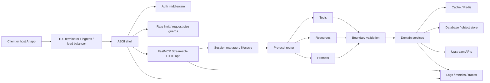
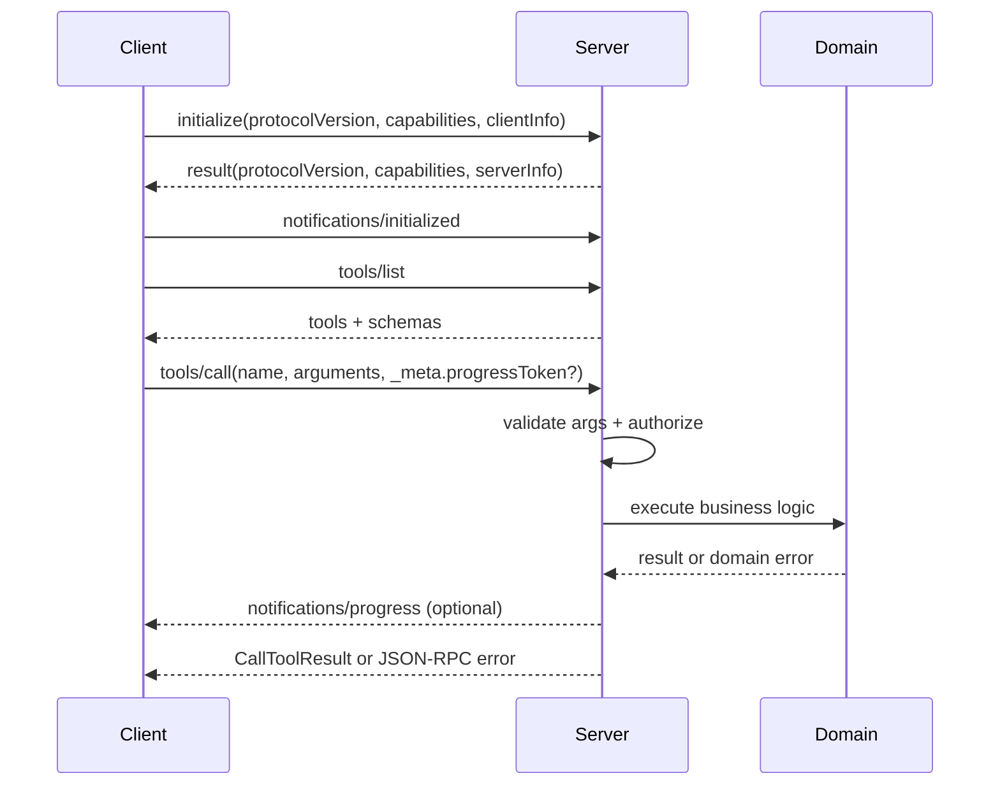
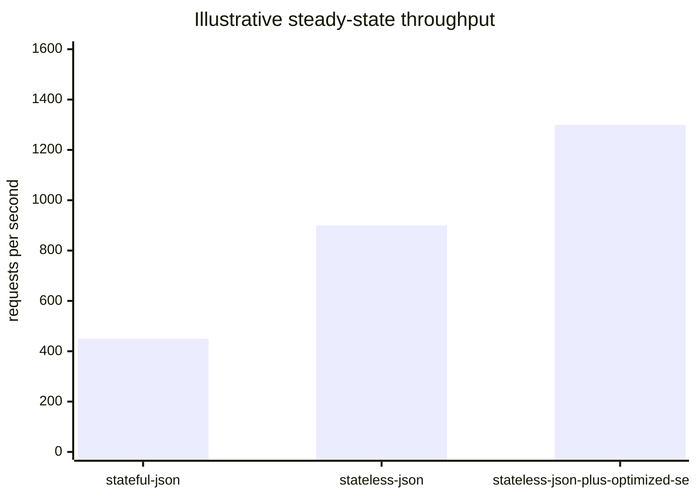
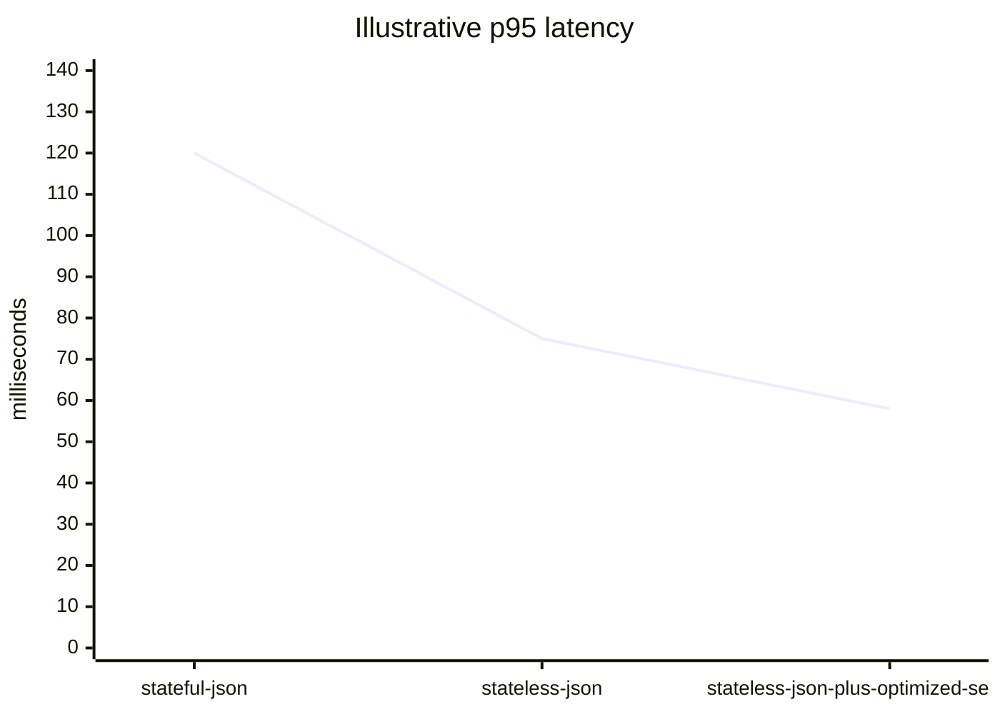

# Building MCP Servers in Python

## Executive summary

For a new Python MCP server in 2026, the highest-confidence default is the official Python MCP SDK running over Streamable HTTP, mounted as an ASGI app, with `stateless_http=True` and `json_response=True` unless you have a concrete need for long-lived server-side session state. That recommendation follows both the official MCP transport guidance and the Python SDK’s own production note that Streamable HTTP is the recommended production transport and that stateless JSON responses scale best. The current latest published MCP spec is version `2025-11-25`, and the Python SDK release notes explicitly call out alignment with that spec revision. citeturn34search1turn8view1turn6view4

Architecturally, the safest design is to keep transport handling, authentication, validation, business logic, and persistence separate. MCP itself is a JSON-RPC 2.0 protocol with a strict initialization lifecycle, explicit capability negotiation, and typed primitives for tools, resources, and prompts. In practice, that means you should validate every tool input at the boundary, declare only the capabilities you actually implement, keep tool listings deterministic, externalize mutable state when you need horizontal scale, and instrument the server with metrics, logs, and traces from day one. citeturn31view0turn31view1turn34search4turn32view1turn33view0turn24search3turn23search3

For the Python runtime, the prompt did not specify a version, load envelope, or hosting environment. A conservative assumption is Python 3.12: modern enough for strong `asyncio` primitives and ecosystem maturity, while staying comfortably within the MCP SDK floor of `>=3.10` and the current support windows documented by major auth, observability, and serialization libraries. citeturn30search0turn11search0turn11search6turn21search7turn24search3turn20search0

The main practical conclusion is simple: start with the official SDK, Streamable HTTP, Starlette or FastAPI as the outer ASGI shell, Uvicorn as the default server, Pydantic for schema-first correctness, HTTPX for outbound calls, and `cryptography` plus JWT/OAuth tooling for auth. Then profile before introducing faster serializers such as `msgspec` or `orjson`; those libraries are powerful, but they belong behind proven bottlenecks, not in your first draft. citeturn6view0turn11search18turn12search0turn18view0turn19view0turn20search0turn22view0turn21search4turn21search7

## Official protocol baseline

The official MCP reading order that matters most for implementers is: the latest specification (`2025-11-25`) for the normative contract, the lifecycle chapter for initialization/version negotiation, the transports chapter for Streamable HTTP and session semantics, the authorization chapter for OAuth-based HTTP protection, and the server-feature chapters for tools, resources, and prompts. The dated specification model is important in itself: MCP versions are negotiated explicitly during `initialize`, so compatibility is not “latest by default”; it is an agreed protocol version for a given connection. citeturn34search1turn31view1turn1view0turn2search1turn34search4turn32view1turn33view0

The March 2025 revision is still worth reading even if you build for `2025-11-25`, because it marked the major protocol shift toward Streamable HTTP, OAuth 2.1-style authorization, JSON-RPC batching support, elicitation, and structured tool content. The November 2025 revision then added or clarified several compatibility-relevant items: experimental tasks, OpenID Connect discovery support, improved consent and discovery behavior, clarified HTTP `Origin` handling, JSON Schema 2020-12 as the default dialect, and guidance that input validation failures should surface as tool execution errors rather than protocol errors so models can self-correct. citeturn0search12turn34search3

At the wire level, MCP inherits JSON-RPC 2.0 semantics: requests have `jsonrpc`, `id`, `method`, and optional `params`; responses echo the same `id` and carry either `result` or `error`; notifications have no `id`; and implementations may send JSON-RPC batches but must, at minimum, be able to receive them. MCP tightens JSON-RPC in a few ways, including non-null request IDs and uniqueness of IDs within a session. citeturn31view0turn9search0

The lifecycle is strict. `initialize` must be the first real interaction, the client sends its supported protocol version and capabilities, the server responds with its own protocol version and capabilities, and the client then sends `notifications/initialized` before normal operation begins. Two implementation consequences follow. First, connection bootstrap logic must be explicit in tests and clients. Second, server code should not assume any capability until negotiation succeeds. citeturn31view1

Transport choice is no longer ambiguous for greenfield remote systems. The current MCP transport chapter defines Streamable HTTP as an HTTP POST channel with optional SSE streaming and an optional GET SSE endpoint for server-to-client streams. The transport supports both stateful and stateless operation; when stateful, the server issues an `Mcp-Session-Id`, and when stateless, requests should be independently processable. The Python SDK mirrors that guidance by explicitly recommending Streamable HTTP with stateless JSON responses for production. The same SDK documentation also notes that SSE is being superseded by Streamable HTTP, which makes SSE mainly a legacy-compatibility choice rather than a strategic default. citeturn1view0turn8view1turn37view2

Authorization is intentionally scoped. The base protocol says HTTP transports should follow the MCP authorization framework, while stdio transports should not, and should instead obtain credentials from the environment. The official authorization docs and SDK both position an MCP server as an OAuth 2.1-style resource server that validates tokens issued by a separate authorization server, using RFC 9728 protected resource metadata for discovery and RFC 8414 authorization server metadata as part of the discovery chain. For a Python implementer, that means remote MCP auth should be treated as standards-based OAuth, not as an ad hoc bearer-token convention, unless you are deliberately building a private, non-standard deployment. citeturn31view0turn2search0turn2search1turn8view2turn10search0turn9search7

Finally, the schema model matters more than many first implementations realize. The official base overview identifies a TypeScript schema as the source of truth and a generated JSON Schema as the tooling-facing derivative. The `2025-11-25` changelog sets JSON Schema 2020-12 as the default dialect, and the tools chapter explicitly documents examples for both default 2020-12 and explicit draft-07 usage. If you need long-lived compatibility, pin your protocol version, pin your SDK version, and be explicit about schema dialect when you have clients that are not uniformly current. citeturn31view0turn34search3turn34search4turn9search1

## Python ecosystem and library choices

Because MCP servers sit at the boundary between protocol correctness and systems engineering, the most important library decisions are not “fastest benchmark wins” but “which layer owns which responsibility.” The table below reflects the most defensible defaults for greenfield work. It is grounded in the official MCP SDK docs, Python’s async docs, ASGI server documentation, and primary docs for validation, serialization, HTTP, and auth tooling. citeturn6view0turn11search0turn11search6turn12search0turn12search1turn13search3turn13search1turn14search3turn18view0turn19view0turn20search0turn22view0turn21search4turn21search7

| Layer | Best default | Strong alternatives | Use it when | Main trade-off |
|---|---|---|---|---|
| MCP protocol implementation | `mcp` official Python SDK with `FastMCP` | `mcp` low-level server APIs | Use `FastMCP` for most servers; drop to low-level APIs for custom lifecycle, schema, or transport control | `FastMCP` is much faster to ship; low-level APIs expose more knobs but more protocol surface |
| Async model | stdlib `asyncio` | AnyIO | Use `asyncio` for normal Python services; add AnyIO if you want unified cancellation/task-group patterns across backends | `asyncio` is universal; AnyIO gives cleaner structured concurrency semantics |
| Outer web shell | Starlette | FastAPI, aiohttp | Use Starlette when MCP is the primary concern and you just need ASGI composition; use FastAPI if you also expose a first-class REST/admin API | FastAPI adds productivity and docs; Starlette is leaner and closer to the metal |
| ASGI server | Uvicorn | Hypercorn | Use Uvicorn for the simplest default deployment; choose Hypercorn if you need richer protocol/runtime combinations such as HTTP/2-oriented deployments | Uvicorn is operationally simpler; Hypercorn is more flexible |
| Outbound HTTP | HTTPX | aiohttp client | Use HTTPX for most tool/resource backends and test harnesses, especially ASGITransport-based tests; prefer aiohttp if your whole stack is already aiohttp-native | HTTPX has excellent DX and testability; aiohttp gives one-stack HTTP+WS |
| WebSocket support for adjacent channels | `websockets` | aiohttp WS | Use only if your application needs non-MCP realtime paths such as dashboards or control channels | WebSockets are not MCP’s primary greenfield transport anymore |
| Validation and schema generation | Pydantic | `msgspec` | Use Pydantic first for correctness, rich typing, JSON Schema, and settings support | Pydantic is not always the fastest |
| Hot-path serialization | `orjson` or `msgspec` after profiling | stdlib `json` | Add when serialization is proven to be a bottleneck | Faster serialization can complicate model integration or require adapter code |
| Cryptography and auth | `cryptography` plus PyJWT or Authlib | SDK `TokenVerifier` integration on top of those | Use `cryptography` as the primitive layer, PyJWT for JWT verification, Authlib for fuller OAuth/OIDC client/server workflows | More standards coverage means more moving parts |

A good baseline stack for an unspecified production environment is therefore: Python 3.12, official `mcp` SDK, Starlette or FastAPI as the outer app, Uvicorn, Pydantic, HTTPX, `cryptography`, and either PyJWT or Authlib depending on how much OAuth/OIDC surface you need. Add OpenTelemetry and Prometheus instrumentation immediately, and introduce `msgspec` or `orjson` only when profiling shows boundary serialization is materially affecting throughput or p95 latency. citeturn30search0turn11search18turn12search0turn18view0turn13search3turn22view0turn21search4turn21search7turn24search3turn24search1turn19view0turn20search0

The specific library behaviors that matter most to MCP servers are also unusually clear in the primary docs. Python’s `asyncio` docs emphasize task groups, cancellation, and the event loop as core concurrency machinery. AnyIO documents cancel scopes and task groups with stronger structured-concurrency semantics. HTTPX documents async clients and ASGI transport, which is particularly useful for MCP integration tests. `aiohttp` explicitly recommends long-lived client sessions for connection pooling. `websockets` focuses on correctness, robustness, performance, and keepalive/latency controls. Pydantic emphasizes validation and JSON Schema generation. `msgspec` emphasizes combined validation and serialization speed. `orjson` emphasizes fast, standards-compliant JSON. And `cryptography` explicitly distinguishes safe high-level recipes from the more dangerous hazmat layer. citeturn11search0turn11search6turn12search2turn13search0turn13search14turn13search7turn14search3turn14search12turn18view0turn19view0turn20search0turn22view0

## Reference architecture for production MCP servers

A production MCP server is easiest to reason about when you treat it as five stacked layers: transport, session/lifecycle, protocol routing, domain execution, and platform concerns. Transport terminates HTTP and authentication. Session/lifecycle manages initialization, capability negotiation, cancellation, and optional resumption/session IDs. Protocol routing maps MCP methods such as `tools/list`, `tools/call`, `resources/read`, and `prompts/get` to implementation code. Domain execution performs the actual work against databases or upstream APIs. Platform concerns handle persistence, rate limiting, telemetry, and scaling. That decomposition aligns directly with the spec’s separation of transport, lifecycle, primitives, and utilities, and with the SDK’s separation of `FastMCP`, mounted ASGI apps, session managers, typed lifespan context, and low-level handlers. citeturn31view3turn31view2turn6view0turn38view0turn38view1

Greenfield deployments should be stateless unless a protocol feature forces state. Stateless MCP servers are easier to autoscale, easier to place behind generic load balancers, and easier to recover after failures. Use state only for things that are actually durable or shared: long-running jobs, subscriptions, resumable streams, rate-limit counters, audit logs, and maybe cached capability lists. Even in those cases, keep the server process itself disposable and move state into an external store such as Redis or PostgreSQL. The official SDK’s recommendation of stateless Streamable HTTP JSON responses for production is the clearest signpost here. citeturn8view1

Validation should happen twice. First, validate protocol-facing arguments at the MCP boundary. Second, validate domain-specific invariants inside your service layer. That split matters because MCP tool schemas help models self-form requests, but they do not replace application rules such as tenancy checks, authorization scopes, cardinality limits, or idempotency constraints. The official tools and prompts docs both emphasize validation and safe handling, and the spec changelog explicitly clarifies that input validation failures should be surfaced as tool execution errors so models can repair their own calls. citeturn34search4turn33view0turn34search3

Model routing should remain optional and explicit. MCP servers can expose tools, resources, and prompts without embedding any model SDK. If you do need model access, the protocol already provides sampling as a client feature, which lets the server remain model-independent and request generation from the client application instead. That is the architectural sweet spot for many servers: they remain protocol servers, not mini agent platforms. If you later add model-aware workflows, gate them per capability and treat them as policy-driven features with budgets, cancellation, and audit metadata. citeturn31view2turn34search1

Load balancing strategy depends on whether the server is stateful and on whether intermediaries must inspect request attributes. In the usual stateless case, any standard L7 reverse proxy or ingress path works. In more advanced cases, the tools spec documents the `x-mcp-header` schema extension, which allows selected tool parameters to be mirrored into HTTP headers so load balancers, proxies, or WAFs can route on them without parsing the body. That feature should be used sparingly, but it is valuable when multi-tenant routing or policy segmentation must happen before the request reaches the application process. citeturn32view0

Observability should be designed around request correlation, not just logs. The SMP-like temptation is to “just log method names,” but MCP gives you enough structure to do better: request IDs, progress notifications, capability negotiation state, tool names, resource URIs, upstream latency, auth decisions, and client metadata should all be traceable across spans, metrics, and logs. OpenTelemetry’s Python docs support traces and metrics today, while Prometheus client libraries remain the most direct way to expose process and application metrics to a scraping system. citeturn38view1turn24search3turn24search2turn23search3turn24search1

The following architecture is a good reference shape for a cloud-agnostic MCP service. It matches the current MCP transport/lifecycle model and the Python SDK’s mounted-ASGI/session-manager guidance. citeturn1view0turn31view1turn37view0turn38view0



And this is the sequence that every client and test harness should model explicitly. citeturn31view1turn31view0turn34search4



## Reference implementation in Python

The implementation below is intentionally opinionated. It assumes Python 3.12, Streamable HTTP, stateless operation, and a mounted ASGI app. It uses the official SDK patterns for typed lifespan context, `FastMCP`, `Context`, structured tool outputs, and `session_manager.run()` for mounted apps. That makes it small enough to understand while remaining structurally suitable for production hardening. citeturn38view0turn38view1turn8view1turn37view0turn39view0

### Server

```python
# server.py
from __future__ import annotations

import contextlib
import time
from collections.abc import AsyncIterator
from dataclasses import dataclass
from typing import Any

import anyio
from pydantic import BaseModel, ConfigDict, Field, ValidationError
from starlette.applications import Starlette
from starlette.responses import JSONResponse
from starlette.routing import Mount, Route

from mcp.server.fastmcp import Context, FastMCP
from mcp.server.session import ServerSession


# ---- Domain models ---------------------------------------------------------

class UserLookupArgs(BaseModel):
    model_config = ConfigDict(extra="forbid")
    user_id: str = Field(pattern=r"^[a-zA-Z0-9_-]{1,64}$")


class UserProfile(BaseModel):
    model_config = ConfigDict(extra="forbid")
    user_id: str
    display_name: str
    status: str
    fetched_at_unix: float


# ---- Infrastructure --------------------------------------------------------

class InMemoryUserStore:
    def __init__(self) -> None:
        self._data: dict[str, dict[str, str]] = {
            "alice": {"display_name": "Alice Example", "status": "active"},
            "bob": {"display_name": "Bob Example", "status": "suspended"},
        }

    async def get(self, user_id: str) -> dict[str, str] | None:
        # Simulate async I/O without blocking the event loop.
        await anyio.sleep(0)
        return self._data.get(user_id)

    async def aclose(self) -> None:
        await anyio.sleep(0)


@dataclass
class AppContext:
    store: InMemoryUserStore


@contextlib.asynccontextmanager
async def app_lifespan(_server: FastMCP) -> AsyncIterator[AppContext]:
    store = InMemoryUserStore()
    try:
        yield AppContext(store=store)
    finally:
        await store.aclose()


# ---- MCP server ------------------------------------------------------------

mcp = FastMCP(
    "UserProfileService",
    stateless_http=True,   # recommended for scalable HTTP deployments
    json_response=True,    # easier testing + cheaper non-streaming responses
    lifespan=app_lifespan,
)


@mcp.resource("service://version")
def service_version() -> str:
    return "2025.05.03"


@mcp.tool()
async def get_user_profile(
    user_id: str,
    ctx: Context[ServerSession, AppContext],
) -> UserProfile:
    """
    Return a structured user profile. The structured return type causes FastMCP
    to generate/validate structured output automatically.
    """
    try:
        args = UserLookupArgs(user_id=user_id)
    except ValidationError as exc:
        # Validation errors should be surfaced as tool-level failures.
        raise ValueError(f"invalid arguments: {exc}") from exc

    await ctx.info(f"lookup request_id={ctx.request_id} user_id={args.user_id}")

    record = await ctx.request_context.lifespan_context.store.get(args.user_id)
    if record is None:
        raise ValueError(f"user not found: {args.user_id}")

    return UserProfile(
        user_id=args.user_id,
        display_name=record["display_name"],
        status=record["status"],
        fetched_at_unix=time.time(),
    )


# ---- Outer ASGI app --------------------------------------------------------

async def healthz(_request) -> JSONResponse:
    return JSONResponse({"ok": True})


@contextlib.asynccontextmanager
async def starlette_lifespan(_app: Starlette):
    # Required when mounting FastMCP into an existing ASGI app.
    async with mcp.session_manager.run():
        yield


app = Starlette(
    routes=[
        Route("/healthz", healthz),
        # The mounted FastMCP app serves its Streamable HTTP endpoint at /mcp
        # because FastMCP's default streamable_http_path is "/mcp".
        Mount("/", app=mcp.streamable_http_app()),
    ],
    lifespan=starlette_lifespan,
)
```

This server deliberately returns a typed Pydantic model from the tool. That aligns with the SDK’s structured-output support, which automatically validates compatible return annotations and still preserves unstructured compatibility behavior for older clients. It also uses the official typed lifespan pattern so caches, database pools, and HTTP clients can be initialized once and accessed through `ctx.request_context.lifespan_context`. citeturn39view0turn38view0turn8view0

### Client

```python
# client.py
from __future__ import annotations

import asyncio

from mcp import ClientSession
from mcp.client.streamable_http import streamable_http_client


async def main() -> None:
    async with streamable_http_client("http://localhost:8000/mcp") as (
        read_stream,
        write_stream,
        _response,
    ):
        async with ClientSession(read_stream, write_stream) as session:
            await session.initialize()

            tools = await session.list_tools()
            print("tools:", [tool.name for tool in tools.tools])

            result = await session.call_tool(
                "get_user_profile",
                arguments={"user_id": "alice"},
            )
            print("structured:", result.structuredContent)
            print("is_error:", result.isError)


if __name__ == "__main__":
    asyncio.run(main())
```

The client code follows the SDK’s own Streamable HTTP examples: create the transport streams, construct a `ClientSession`, call `initialize`, and then use typed helpers such as `list_tools()` and `call_tool()`. That is the right level of abstraction for nearly all Python MCP clients. citeturn8view4turn40view0

### Context lifecycle

If your server has real infrastructure dependencies, the right pattern is to keep them in lifespan context rather than module globals or per-request constructors. The SDK documents exactly that style. citeturn38view0

```python
from collections.abc import AsyncIterator
from contextlib import asynccontextmanager
from dataclasses import dataclass

import httpx
from mcp.server.fastmcp import FastMCP


@dataclass
class AppContext:
    http: httpx.AsyncClient
    # db: DatabasePool
    # cache: RedisClient


@asynccontextmanager
async def app_lifespan(_server: FastMCP) -> AsyncIterator[AppContext]:
    http = httpx.AsyncClient(timeout=5.0)
    # db = await create_pool(...)
    # cache = await redis.from_url(...)
    try:
        yield AppContext(http=http)
    finally:
        await http.aclose()
        # await cache.aclose()
        # await db.close()
```

### Authentication and token verification add-on

For remote HTTP servers, the protocol direction is OAuth-based auth for MCP over HTTP, with the SDK supporting resource-server behavior and RFC 9728 metadata publication. In a practical deployment, many teams terminate OAuth/JWT verification in an API gateway or ASGI middleware and pass only verified requests to the MCP app. That is entirely compatible with the reference architecture, and it keeps the MCP layer itself focused on protocol work. citeturn8view2turn2search1turn31view3

```python
# auth_middleware.py
from __future__ import annotations

import os

import jwt
from starlette.middleware.base import BaseHTTPMiddleware
from starlette.requests import Request
from starlette.responses import JSONResponse


class BearerJWTMiddleware(BaseHTTPMiddleware):
    async def dispatch(self, request: Request, call_next):
        if request.url.path == "/healthz":
            return await call_next(request)

        auth = request.headers.get("authorization", "")
        if not auth.startswith("Bearer "):
            return JSONResponse({"detail": "missing bearer token"}, status_code=401)

        token = auth.removeprefix("Bearer ").strip()
        try:
            jwt.decode(
                token,
                os.environ["JWT_PUBLIC_KEY_PEM"],
                algorithms=["RS256"],
                issuer=os.environ["JWT_ISSUER"],
                audience=os.environ["JWT_AUDIENCE"],
                options={"require": ["exp", "iss", "aud", "sub"]},
            )
        except jwt.InvalidTokenError:
            return JSONResponse({"detail": "invalid token"}, status_code=401)

        return await call_next(request)
```

For a standards-heavy deployment, replace middleware-only verification with the SDK’s `TokenVerifier` and `AuthSettings` flow so the server behaves as an OAuth-aware resource server rather than merely a bearer-token-protected HTTP application. citeturn8view2

### Error handling

The key design rule is to separate repairable input failures from operational failures. Invalid arguments, missing resources, or violated business rules should result in tool-level execution failures with clear messages that a model can fix. Upstream timeouts, dependency failures, and cancellation should be logged separately and mapped to non-leaky error text. The spec changelog explicitly clarified the distinction between tool execution errors and protocol errors for this reason. citeturn34search3

```python
@mcp.tool()
async def resilient_lookup(
    user_id: str,
    ctx: Context[ServerSession, AppContext],
) -> UserProfile:
    try:
        args = UserLookupArgs(user_id=user_id)
        record = await ctx.request_context.lifespan_context.store.get(args.user_id)
        if record is None:
            raise ValueError(f"user not found: {args.user_id}")
        return UserProfile(
            user_id=args.user_id,
            display_name=record["display_name"],
            status=record["status"],
            fetched_at_unix=time.time(),
        )
    except ValidationError as exc:
        raise ValueError(f"invalid arguments: {exc}") from exc
    except anyio.get_cancelled_exc_class():
        await ctx.warning(f"request cancelled request_id={ctx.request_id}")
        raise
    except Exception as exc:
        await ctx.error(f"internal failure request_id={ctx.request_id}: {exc!r}")
        raise RuntimeError("temporary internal server failure") from exc
```

### Tests

The combination of `pytest` fixtures and HTTPX’s ASGI transport is a strong default for MCP server integration tests, because it lets you run the mounted ASGI app directly in process. The snippet below tests the real JSON-RPC handshake and a tool call without standing up an external server. citeturn35search0turn35search6turn13search14

```python
# test_server.py
from __future__ import annotations

import pytest
from httpx import ASGITransport, AsyncClient

from server import app


def rpc(req_id: int, method: str, params: dict | None = None) -> dict:
    body = {"jsonrpc": "2.0", "id": req_id, "method": method}
    if params is not None:
        body["params"] = params
    return body


@pytest.mark.anyio
async def test_initialize_and_call_tool():
    transport = ASGITransport(app=app)

    async with AsyncClient(transport=transport, base_url="http://testserver") as client:
        init = await client.post(
            "/mcp",
            json=rpc(
                1,
                "initialize",
                {
                    "protocolVersion": "2025-11-25",
                    "capabilities": {},
                    "clientInfo": {"name": "pytest-client", "version": "0.1.0"},
                },
            ),
        )
        init.raise_for_status()
        init_data = init.json()
        assert init_data["result"]["serverInfo"]["name"] == "UserProfileService"

        initialized = await client.post(
            "/mcp",
            json={"jsonrpc": "2.0", "method": "notifications/initialized"},
        )
        initialized.raise_for_status()

        call = await client.post(
            "/mcp",
            json=rpc(
                2,
                "tools/call",
                {"name": "get_user_profile", "arguments": {"user_id": "alice"}},
            ),
        )
        call.raise_for_status()
        call_data = call.json()

        assert call_data["result"]["structuredContent"]["user_id"] == "alice"
        assert call_data["result"]["isError"] is False
```

A unit test layer should still exist beneath this integration layer. Test your validation and business logic directly, and let protocol tests verify MCP framing, initialization, and structured result behavior. citeturn35search6turn35search15turn39view0

## Deployment, operations, security, and performance

The most robust deployment shape is “one process per container, many containers per service.” That is consistent with Docker’s image-building guidance, FastAPI’s deployment concepts for ASGI apps, and Kubernetes’ scaling model through Deployments and HorizontalPodAutoscalers. In other words: keep the application process simple, let the orchestrator replicate it, and prefer platform-level scaling over in-process complexity unless measurements force a different choice. citeturn23search0turn23search17turn11search5turn11search20turn23search1turn23search9

The deployment choices below are the ones that matter most for MCP servers specifically. citeturn8view1turn11search16turn23search1turn27search1

| Deployment shape | Best for | Advantages | Costs / risks |
|---|---|---|---|
| Local stdio process | Desktop integrations, developer tools, local automation | Lowest overhead, simplest security model, no network stack | Not remotely accessible; auth flows differ from HTTP |
| Single container, single replica | Small internal services and early rollout | Minimal ops complexity; easy debugging | No HA; poor fault tolerance |
| Stateless Streamable HTTP replicas behind a load balancer | Default production shape | Easiest horizontal scaling; simplest incident recovery; cheapest caching story | Requires external stores for durable state |
| Stateful HTTP replicas with shared backing store | Subscriptions, resumable streams, durable jobs | Supports richer interaction patterns | More moving parts: session storage, consistency, failover, stickiness concerns |
| Kubernetes Deployment + Service + HPA | Variable or unknown load | Standardized rollout, scaling, health probes, self-healing | Higher operational overhead |

For CI/CD, the safest pipeline is boring on purpose: lock dependencies, lint and type-check, run unit and integration tests, build a pinned image, run a smoke test against the built container, and only then deploy. The GitHub Actions Python workflow docs cover build-and-test pipelines and PyPI trusted publishing; uv’s project docs cover lockfiles and dependency management; Docker’s best-practice docs cover multi-stage builds, pinned base images, cache use, and CI-based builds. citeturn28search0turn28search14turn28search1turn28search11turn23search0

Monitoring should be split into four signals. Logs answer “what happened.” Metrics answer “how often and how bad.” Traces answer “where time went.” Health checks answer “should traffic continue.” OpenTelemetry Python currently describes traces and metrics as stable and logs as still developing, so the most conservative practice today is structured application logging plus OTel for traces/metrics and Prometheus scraping for counters, histograms, gauges, and process metrics. At minimum, capture request count, error count, in-flight requests, p50/p95/p99 tool latency, upstream dependency latency, auth failures, rate-limit drops, session count, and event-loop lag. citeturn24search3turn24search2turn23search3turn24search1

Security hardening is broader than token verification. TLS termination is mandatory for any non-local HTTP deployment. Input validation should reject oversized payloads, unknown fields, malformed identifiers, and unsafe URI/resource selectors before business logic runs. HTTP auth should prefer OAuth 2.1-style flows and short-lived access tokens for public or multi-user systems, while stdio deployments should use environment-sourced credentials instead of trying to retrofit HTTP auth semantics. Token/session handling should use short TTLs, aud/iss validation, secure storage for refresh secrets, and explicit scope checks. The MCP security best-practices page additionally warns about token passthrough, DNS rebinding, session hijacking, and confused-deputy risks, which are especially relevant if your MCP server fronts privileged internal systems. citeturn2search1turn8view2turn4search0turn22view0turn21search4turn21search7

Performance tuning should start with measurement discipline rather than micro-optimizations. Benchmark the exact mix of `initialize`, `tools/list`, `tools/call`, `resources/read`, auth, and upstream I/O you expect in production. Warm up the service, separate cold-start and steady-state numbers, and record not just throughput but also p95/p99 latency, error rate, memory per connection, queue depth, auth-verifier latency, and CPU time spent in validation versus serialization. Locust is a strong choice when you want load tests written in Python and modeled as user flows; k6 is strong when you want protocol- and CI-friendly API load tests and distributed execution patterns. citeturn25search11turn25search7turn26search2turn26search0turn26search3

The most common tuning wins in MCP servers are not exotic. They are avoiding blocking calls in tool handlers, reusing outbound HTTP clients, validating once per boundary, preferring stateless transport where possible, and only introducing faster serialization when profiling proves that JSON encoding/decoding is dominant. The Python async docs, aiohttp pooling guidance, websockets performance guidance, and msgspec/orjson documentation all point in this direction from different angles. citeturn11search6turn13search7turn14search1turn14search18turn19view0turn20search0

The following charts are illustrative only. They are not measured benchmark data; they show the trade-off patterns you should expect to test for in your own environment.





## Testing, migration, and compatibility

A mature MCP testing strategy should have at least five layers. Unit tests validate pure business logic and schema adapters. Integration tests exercise the real MCP handshake and JSON-RPC methods over the actual transport surface. Property-based tests check invariants across many argument combinations. Fuzzers attack parsers, schema boundaries, and low-level request handling. Chaos tests verify that autoscaling, cancellation, retries, and dependency failures behave sanely under disruption. Pytest fixtures and parametrization cover the first two layers well; Hypothesis is the natural fit for property-based testing; Atheris is the primary Python-native coverage-guided fuzzing option; and Chaos Mesh or k6-driven fault injection are appropriate choices once you test in Kubernetes-like environments. citeturn35search0turn35search10turn25search1turn25search5turn25search2turn36search1turn36search7turn26search2

Compatibility work starts at the initial handshake. Always pin the protocol version your client and server expect, and test downgrade behavior explicitly. Declare only the MCP capabilities you actually implement. Keep tool, resource, and prompt discovery stable and deterministic. If you must support older clients, take advantage of the SDK’s current structured-output behavior, which preserves unstructured compatibility alongside structured content. Do not adopt experimental tasks in production unless you have version-gated tests for them and a clear rollback story. citeturn31view1turn34search4turn32view1turn33view0turn39view0turn34search0

Migration strategy is easiest when you change one dimension at a time. If you are on SSE, move first to Streamable HTTP while keeping the same tool/resource semantics. If you are stateful, externalize long-lived state into a shared store before introducing horizontal scaling. If you are moving from loosely typed payloads to schema-first tools, add explicit models, preserve existing field names, and keep compatibility content around until all known clients consume structured output correctly. If you need to move schema dialects, use explicit `$schema` declarations rather than silently depending on consumers to follow the new default. citeturn37view2turn8view1turn39view0turn34search3

For change management, use canary deployments and client/server version matrices. At minimum, test N and N-1 SDKs against the same server image, and test your server against clients pinned to the current production protocol version and the next target version. Because MCP’s dated-version model is explicit and visible during `initialize`, you can make protocol rollout safer than many ad hoc RPC systems, but only if you actually automate those matrix tests. citeturn31view1turn6view4

### Open questions and limitations

The official MCP spec is evolving quickly, and several of the most interesting capabilities in `2025-11-25`, especially tasks, remain explicitly experimental. Auth-related discovery behavior also continues to receive clarification across spec revisions. Treat those areas as version-pinned features, not as eternal contracts. citeturn34search0turn34search3

The report assumes no specific cloud provider, no specific load profile, and no specific persistence requirements. That means the architectural recommendations intentionally favor the most generally robust default: stateless Streamable HTTP with externalized durable state only where necessary. Your actual breakpoint between “simple enough” and “needs Redis/Postgres/job queues” depends on tool latency, payload size, authentication mode, and whether your server performs mostly local compute or mostly upstream I/O. citeturn8view1turn26search0turn26search3