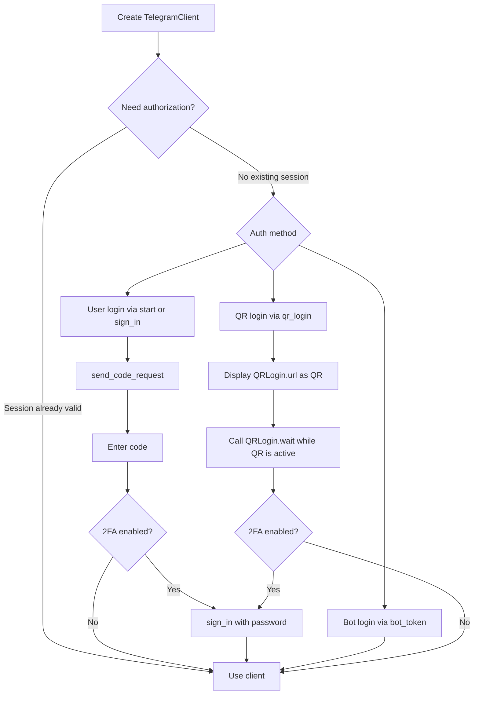
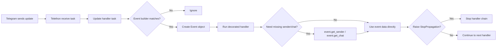

# Telethon 1.43.2 Deep Guide for Intermediate Python Developers

## Executive Summary

The most practical target for new Telethon work today is **Telethon 1.43.2**, which is the latest stable package published on PyPI as of **April 20, 2026**. The public stable documentation and changelog, however, are currently published as **Telethon 1.43.0**, and the official `v1.43` changelog section documents the major changes for that line. In parallel, the project has moved away from entity["company","GitHub","developer platform"] to entity["organization","Codeberg","forgejo hosting service"], while the archived GitHub tags page publicly stops at `v1.42.0`; for `1.43.1` and `1.43.2`, the clearest official public release trail is **PyPI + the official TelethonUpdates channel + the 1.43 changelog**. citeturn15view0turn11view0turn32search0turn5view0

Functionally, the `1.43` line is still **Telethon v1 in maintenance mode**: it keeps tracking new Telegram API layers and accepts bug fixes and small additions, but it is not a ground-up redesign. The `v1.43` changelog reports **layer 224**, migration to a Hatch-based build process, more RPC error classes, a proxy warning when `python-socks` is missing, support for styling inline buttons, and fixes around Python 3.14, `sqlite3` importability, `InvalidBufferError`, and `iter_messages(..., scheduled=True, reverse=True)`. The official update stream around the patch releases also shows follow-up fixes such as installation with UV, high CPU on remote close, and additional download/path handling cleanups. citeturn11view0turn32search0turn32search1

For day-to-day engineering, the most important conclusions are straightforward. Use the **async API first**, treat `telethon.sync` as a convenience layer rather than a foundation, keep **one event loop** and preferably one `asyncio.run(main())`, use **different session files per process/device**, install **`cryptg`** if you move a lot of media, and design your code to **back off on flood waits** rather than trying to brute-force throughput. Telethon’s own docs explicitly warn about non-thread-safe loops, session reuse problems, auto-sleep thresholds for flood waits, and the fact that update handlers can be processed sequentially or in parallel depending on client configuration. citeturn25view0turn27view0turn27view4turn29view0turn28view4

This report assumes **intermediate Python developers**, no OS-specific constraint, and no need for Windows-only guidance unless behavior differs. It centers on **stable Telethon 1.43.2**, while noting where the latest public docs still reflect 1.43.0. citeturn15view0turn17view0

## Release State and What Changed

Telethon is a Python 3 MTProto client for entity["company","Telegram","messaging platform"] that supports both user accounts and bot accounts. PyPI lists **Telethon 1.43.2** as the latest version and marks the project as production/stable, with a requirement of **Python >= 3.5** and a `cryptg` extra. At the same time, the stable docs identify themselves as **Telethon 1.43.0**, and the project description says **Telethon v1 is mostly in maintenance mode**: new layers are still updated, bug fixes are welcome, and small additions may still land. citeturn15view0turn17view0

The `v1.43` changelog is the main official change log for the latest stable line. It records **scheme layer 224**, a Hatch-oriented packaging update, and the following notable additions and fixes: more RPC error classes, a warning when proxies are configured without `python-socks`, support for styles on inline buttons, the project no longer being hosted on GitHub, an explicit anti-AI policy, treating any RPC error as transient while getting differences, expandable HTML blockquotes, Python 3.14 compatibility fixes, re-enabled importability without `sqlite3`, improved `InvalidBufferError` handling, and a fix for `iter_messages` with scheduled messages in reverse. citeturn11view0

The patch-level picture is slightly messier because the project moved homes. The official TelethonUpdates channel shows the repository migration announcement to Codeberg, later posts for **Update to layer 224**, **Fix installation with UV**, **Fix `get_running_loop()` for Python 3.14**, **Fix high CPU usage when connection is closed by remote**, **Filter `None` out of possible names on download**, and finally **Bump to v1.43.2**. The archived GitHub tags page, by contrast, shows the repository as read-only and publicly lists tags only through **v1.42.0**. In other words: the public GitHub release trail is now incomplete for the latest stable patches. citeturn8search0turn32search0turn5view0

There is also a **v2.0.0a0** documentation track visible in the docs downloads, which indicates a pre-release line exists, but the latest stable package you can target confidently from PyPI remains **1.43.2**. For production guidance, that makes 1.43.2 the right anchor. citeturn12search2turn15view0

## Installation and Environment Setup

Telethon’s official install instructions are intentionally simple: upgrade `pip`, then install or upgrade `telethon`, and verify it with `python3 -c "import telethon; print(telethon.__version__)"`. The docs also document an unreleased development install from a `v1.zip` archive hosted on Codeberg, but explicitly warn that development versions are not recommended for production use. citeturn17view0

The Python-version story deserves nuance. Official PyPI metadata still says **Python >= 3.5** and its classifiers still stop at 3.8, but the `1.42` and `1.43` changelog entries explicitly mention **Python 3.14 fixes**, which shows the project is still being kept compatible with newer interpreters even if the classifiers lag. For a new deployment today, the safest practical recommendation is to use a currently maintained CPython such as **3.11–3.13**, or **3.14** if it matches your broader stack, rather than planning around 3.5-era environments. citeturn15view0turn11view0

Telethon’s docs only prescribe `pip`, but for real projects you will be better off isolating it in `venv`, `virtualenv`, or `conda`. A practical setup pattern is:

```bash
# venv
python -m venv .venv
# activate it, then:
python -m pip install --upgrade pip
python -m pip install "telethon==1.43.2" cryptg pillow aiohttp hachoir "python-socks[asyncio]"
python -c "import telethon; print(telethon.__version__)"

# virtualenv
virtualenv .venv
# activate it, then run the same pip commands

# conda
conda create -n telethon python=3.12
conda activate telethon
python -m pip install --upgrade pip
python -m pip install "telethon==1.43.2" cryptg pillow aiohttp hachoir "python-socks[asyncio]"
python -c "import telethon; print(telethon.__version__)"
```

**Expected output:** the final line should print `1.43.2`.

The recommended dependency strategy is **pin Telethon deliberately**. Telethon’s own changelog has long advised fixed or compatibility-constrained dependency versions, because your code cannot honestly predict future API-surface changes. In practice, that means either `telethon==1.43.2` for strict reproducibility or `telethon~=1.43.0` if you want to admit further `1.43.x` bugfixes only. The same principle applies to your lockfile for optional dependencies. citeturn9view0

The optional dependency story is directly documented. `cryptg` materially speeds up encryption/decryption and is the first extra to install if you work with lots of updates or media. `pillow` lets Telethon resize large images when sending photos. `aiohttp` is required to download `WebDocument` media. `hachoir` extracts metadata for sent documents. For proxies, the docs now tell you to install `python-socks[asyncio]`, and the `1.43` changelog says Telethon warns you if a proxy is configured without it. citeturn17view0turn18view0turn11view0

## Authentication and Session Management

Before any login flow, you must get your own **API ID** and **API hash** from `my.telegram.org`. The docs are very explicit that the API hash is **secret** and **Telegram will not let you revoke it**, so treat it as a long-lived credential rather than something you can casually rotate later. The API ID/hash belongs to your application, not a specific phone number, and can be used with user accounts or bot accounts. citeturn18view0

The official auth surface is compact: `start`, `send_code_request`, `sign_in`, `qr_login`, `log_out`, and `edit_2fa`. `start()` is the most convenient default because it will connect, sign in if needed, and handle 2FA interactively. If the loop is already running, it returns a coroutine you must await. Explicit `sign_in()` remains the right choice when you want to fully control phone-code and password handling. QR login is officially supported through `qr_login()` plus the `QRLogin.wait()` lifecycle, and bot sign-in is supported through `start(bot_token=...)` or `sign_in(bot_token=...)`. Not all requests are available to bot accounts. citeturn19view1turn19view3turn19view0turn21search0

The auth methods differ materially in operational feel:

| Method | Best use | What you provide | Key caveats |
|---|---|---|---|
| `start()` | Most applications and scripts | Phone or bot token; interactive callbacks optional | Easiest path; handles 2FA; sync-magic behavior depends on loop state |
| `send_code_request()` + `sign_in()` | Custom login UX, web apps, CLIs | Phone, login code, optionally 2FA password | More control; you own retries and prompts |
| `qr_login()` | Device-pairing and desktop-like flows | A rendered QR for the `tg://login` URL | Must be connected; `wait()` must already be running; 2FA can still be required |
| `start(bot_token=...)` / `sign_in(bot_token=...)` | Bots using MTProto instead of the Bot API | Bot token plus API ID/hash | Bot accounts cannot use every MTProto request |

Source basis: official signing-in docs, client reference, `sign_in` docs, and `QRLogin` docs. citeturn18view0turn19view1turn19view3turn19view0turn21search0

The flow below condenses the officially documented auth paths. citeturn18view0turn19view3turn19view0turn21search0



A minimal explicit user-login flow with 2FA handling looks like this:

```python
import asyncio
from telethon import TelegramClient, errors

API_ID = 123456
API_HASH = "0123456789abcdef0123456789abcdef"
PHONE = "+10000000000"

async def main():
    client = TelegramClient("user-auth", API_ID, API_HASH)
    await client.connect()

    if not await client.is_user_authorized():
        sent = await client.send_code_request(PHONE)
        code = input("Enter the Telegram code: ").strip()
        try:
            await client.sign_in(PHONE, code, phone_code_hash=sent.phone_code_hash)
        except errors.SessionPasswordNeededError:
            password = input("Enter your 2FA password: ")
            await client.sign_in(password=password)

    me = await client.get_me()
    print(f"Logged in as: {me.id} {me.username or me.first_name}")
    await client.disconnect()

asyncio.run(main())
```

**Expected output:** a line like `Logged in as: 123456789 myusername` after the first successful authorization.

A minimal bot-login flow is even smaller:

```python
from telethon.sync import TelegramClient

API_ID = 123456
API_HASH = "0123456789abcdef0123456789abcdef"
BOT_TOKEN = "123456:AA..."

with TelegramClient("bot-auth", API_ID, API_HASH).start(bot_token=BOT_TOKEN) as bot:
    me = bot.get_me()
    print(f"Bot username: @{me.username}")
```

**Expected output:** a line like `Bot username: @my_bot`.

And a QR-login flow, if you want desktop-style pairing:

```python
import asyncio
from telethon import TelegramClient, errors

API_ID = 123456
API_HASH = "0123456789abcdef0123456789abcdef"

async def display_url_as_qr(url: str) -> None:
    # Replace this with your real QR rendering logic.
    print("Scan this URL as a QR code:", url)

async def main():
    client = TelegramClient("qr-auth", API_ID, API_HASH)
    await client.connect()

    qr = await client.qr_login()
    await display_url_as_qr(qr.url)

    try:
        user = await qr.wait()
    except errors.SessionPasswordNeededError:
        password = input("Enter your 2FA password: ")
        user = await client.sign_in(password=password)

    print(f"Logged in as: {user.id} {user.username or user.first_name}")
    await client.disconnect()

asyncio.run(main())
```

**Expected output:** first the QR URL, then a line identifying the logged-in user after the scan completes.

Sessions are the second half of authentication. By default, passing a string such as `"anon"` creates an **on-disk SQLite session file** (for example, `anon.session`) in the working directory. Sessions store enough information to avoid re-entering the login code, including the authorization key, DC/address details, and cached entities. Telethon provides three built-in session implementations: `SQLiteSession` (default), `MemorySession`, and `StringSession`. You can also disable entity saving with `client.session.save_entities = False` if your workflow does not need access-hash caching. citeturn22view0turn46view0

| Storage | Persistence | Best use | Trade-offs |
|---|---|---|---|
| `SQLiteSession` | On disk | Default choice for most apps | Simple and durable, but reusing the same file across concurrent processes can trigger `database is locked` |
| `MemorySession` | Process memory only | Short-lived jobs, tests, throwaway workers | No disk footprint, but nothing survives process exit |
| `StringSession` | String you save yourself | Containers, serverless, secret managers, CI | Extremely portable, but leaking the string is equivalent to leaking account access |

Source basis: Session Files and FAQ. citeturn22view0turn29view0

Two practical session rules matter more than everything else. First, **never share one physical session between concurrent clients/processes**; Telethon’s FAQ ties this directly to `sqlite3.OperationalError: database is locked` and other session-integrity problems. Second, **treat `StringSession` as a secret credential**; the docs warn that anyone holding it can use your account. citeturn29view0turn22view0

## API Patterns and Runnable Examples

Telethon’s main class is `TelegramClient`, a “god object” that aggregates auth, messages, updates, chats, uploads, downloads, dialogs, users, and bot methods into one common entry point. The official client constructor also exposes important runtime knobs such as `request_retries`, `connection_retries`, `retry_delay`, `auto_reconnect`, `sequential_updates`, `flood_sleep_threshold`, `receive_updates`, `catch_up`, and `entity_cache_limit`. citeturn46view0turn27view0turn27view1turn27view4

The most important everyday methods are summarized below.

| Method | Typical use | Notes |
|---|---|---|
| `start()` | Connect and sign in | Best general entry point |
| `send_message()` | Send plain or formatted text | Supports reply/comment semantics |
| `send_file()` | Send photos, documents, albums, voice, etc. | Telethon’s main media-send API |
| `iter_messages()` / `get_messages()` | Search, paginate, and fetch history | Switches to server-side `messages.Search` when `search`, `filter`, or `from_user` are used |
| `edit_message()` / message `.edit()` | Edit sent content | Friendly wrapper over raw edit APIs |
| `delete_messages()` / message `.delete()` | Delete one or more messages | Batch-friendly |
| `forward_messages()` | Forward existing messages | Also has newer controls like `drop_author`/`drop_media_captions` in recent versions |
| `iter_participants()` / `get_permissions()` / `edit_admin()` / `edit_permissions()` | Group and channel management | `iter_participants(..., aggressive=True)` is retained only for backwards compatibility |
| `add_event_handler()` / `on()` / `run_until_disconnected()` | Event-driven bots and user clients | Event handler concurrency depends on `sequential_updates` |
| `client(request)` | Raw API invocation | Use when no friendly method exists or when you need exact MTProto control |

Source basis: official client reference, full client docs, and the Full API guide. citeturn36search8turn14search4turn41view0

Telethon’s event model is also important to understand. Events are message-like objects, but in handlers some properties may be missing until you explicitly fetch them with `get_...` methods such as `event.get_sender()` and `event.get_input_chat()`. Update handlers run in parallel by default; if you need strict order, create the client with `sequential_updates=True`. You can also stop handler chaining with `telethon.events.StopPropagation`. citeturn23view1turn23view0turn23view2



A minimal send/receive example:

```python
import asyncio
from telethon import TelegramClient, events

API_ID = 123456
API_HASH = "0123456789abcdef0123456789abcdef"

async def main():
    client = TelegramClient("basic-example", API_ID, API_HASH)

    @client.on(events.NewMessage(pattern=r"(?i)^ping$"))
    async def on_ping(event):
        # In event handlers, fetch sender/chat explicitly if you need them.
        sender = await event.get_sender()
        await event.reply(f"pong from Telethon to {sender.id}")

    async with client:
        me = await client.get_me()
        print(f"Connected as {me.id}")

        sent = await client.send_message("me", "ping")
        print(f"Sent message id={sent.id}")

        # Give the event loop a moment so our handler can process the message.
        await asyncio.sleep(2)

asyncio.run(main())
```

**Expected output:** one line identifying your account, then one line with the sent message ID; you should also see a reply message `pong from Telethon to ...` arrive in Saved Messages.

A message-lifecycle example covering reply, edit, forward, and delete:

```python
import asyncio
from telethon import TelegramClient

API_ID = 123456
API_HASH = "0123456789abcdef0123456789abcdef"

async def main():
    async with TelegramClient("message-lifecycle", API_ID, API_HASH) as client:
        original = await client.send_message("me", "Draft from Telethon")
        reply = await client.send_message("me", "Replying now", reply_to=original.id)

        await original.edit("Edited from Telethon")
        await client.forward_messages("me", original.id, "me")

        print(f"original={original.id} reply={reply.id}")

        # Clean up.
        await client.delete_messages("me", [reply.id])

asyncio.run(main())
```

**Expected output:** a line like `original=101 reply=102`. In Saved Messages you will see the original text edited, a reply message, and a forwarded copy; the reply will then be deleted.

A media upload/download example:

```python
import asyncio
from telethon import TelegramClient

API_ID = 123456
API_HASH = "0123456789abcdef0123456789abcdef"
PHOTO_PATH = "example.jpg"  # replace with a real file

def progress(current, total):
    print(f"{current}/{total}")

async def main():
    async with TelegramClient("media-example", API_ID, API_HASH) as client:
        msg = await client.send_file(
            "me",
            PHOTO_PATH,
            caption="Uploaded by Telethon",
            progress_callback=progress,
        )
        print(f"uploaded_message_id={msg.id}")

        downloaded = await msg.download_media(file="downloads/")
        print(f"downloaded_to={downloaded}")

asyncio.run(main())
```

**Expected output:** progress lines during upload/download, then something like `uploaded_message_id=103` and `downloaded_to=downloads/example.jpg`.

An inline-bot example, acting as the bot that answers inline queries:

```python
import asyncio
from telethon import TelegramClient, events

API_ID = 123456
API_HASH = "0123456789abcdef0123456789abcdef"
BOT_TOKEN = "123456:AA..."

async def main():
    bot = TelegramClient("inline-bot", API_ID, API_HASH).start(bot_token=BOT_TOKEN)

    @bot.on(events.InlineQuery)
    async def handler(event):
        builder = event.builder
        reversed_text = event.text[::-1]

        await event.answer([
            builder.article(
                title="Reverse text",
                text=reversed_text,
                description="Returns the query reversed",
            )
        ])

    print("Inline bot is running")
    await bot.run_until_disconnected()

asyncio.run(main())
```

**Expected output:** `Inline bot is running`; when a user invokes your bot inline, the result list should include one article titled **Reverse text**.

And a client-side inline-query example, querying another inline bot:

```python
import asyncio
from telethon import TelegramClient

API_ID = 123456
API_HASH = "0123456789abcdef0123456789abcdef"

async def main():
    async with TelegramClient("inline-query-client", API_ID, API_HASH) as client:
        results = await client.inline_query("like", "telethon")
        print(f"got {len(results)} inline result(s)")
        if results:
            sent = await results[0].click("me")
            print(f"sent inline result into chat, message id={sent.id}")

asyncio.run(main())
```

**Expected output:** one line with the number of results, and one line with the inserted message ID if at least one result exists.

A group/channel management example that lists admins and promotes a user:

```python
import asyncio
from telethon import TelegramClient
from telethon.tl.types import ChannelParticipantsAdmins

API_ID = 123456
API_HASH = "0123456789abcdef0123456789abcdef"
CHAT = "my_supergroup"      # username or invite-resolved entity
TARGET = "some_username"    # user to promote

async def main():
    async with TelegramClient("group-admins", API_ID, API_HASH) as client:
        print("Current admins:")
        async for user in client.iter_participants(CHAT, filter=ChannelParticipantsAdmins):
            print(user.id, user.username, user.first_name)

        await client.edit_admin(
            CHAT,
            TARGET,
            pin_messages=True,
            delete_messages=True,
            title="Moderator",
        )
        permissions = await client.get_permissions(CHAT, TARGET)
        print("is_admin:", permissions.is_admin)

asyncio.run(main())
```

**Expected output:** a list of current admins, then `is_admin: True` after the promotion succeeds.

A search, pagination, and raw-API example:

```python
import asyncio
from telethon import TelegramClient
from telethon.tl.functions.users import GetFullUserRequest

API_ID = 123456
API_HASH = "0123456789abcdef0123456789abcdef"
CHAT = "me"

async def main():
    async with TelegramClient("search-pagination-raw", API_ID, API_HASH) as client:
        print("Search results:")
        async for msg in client.iter_messages(CHAT, search="Telethon", limit=5):
            print(msg.id, msg.text)

        print("\nPagination page 1:")
        page1 = [m async for m in client.iter_messages(CHAT, limit=3)]
        for m in page1:
            print(m.id, m.text)

        if page1:
            oldest_seen = page1[-1].id
            print("\nPagination page 2:")
            async for m in client.iter_messages(CHAT, limit=3, offset_id=oldest_seen):
                print(m.id, m.text)

        print("\nRaw API:")
        full = await client(GetFullUserRequest("me"))
        print(full.full_user.about)

asyncio.run(main())
```

**Expected output:** up to five matching messages, then two paginated slices of history, then your bio/about string from the raw API call.

## Reliability, Performance, and Security

Telethon’s client constructor already exposes the first layer of resilience controls. By default, it uses `request_retries=5`, `connection_retries=5`, `retry_delay=1`, `auto_reconnect=True`, and `flood_sleep_threshold=60`. The library retries requests when Telegram has internal issues (`ServerError`, `RpcCallFailError`), when flood waits are below the configured threshold, and on migrate errors. If the flood/slow-mode wait exceeds the threshold, Telethon raises instead of auto-sleeping. You can also set `raise_last_call_error=True` if you prefer the final RPC error over a generic `ValueError` after automatic retries. citeturn27view0turn27view1turn27view4

A practical resilient-send wrapper looks like this:

```python
import asyncio
from telethon import TelegramClient, errors

API_ID = 123456
API_HASH = "0123456789abcdef0123456789abcdef"

async def safe_send(client, entity, text, attempts=5):
    backoff = 1.0

    for attempt in range(1, attempts + 1):
        try:
            msg = await client.send_message(entity, text)
            print(f"sent on attempt {attempt}, id={msg.id}")
            return msg

        except errors.FloodWaitError as e:
            print(f"Flood wait: sleeping {e.seconds}s")
            await asyncio.sleep(e.seconds)

        except (errors.ServerError, errors.RpcCallFailError, OSError) as e:
            print(f"Transient failure on attempt {attempt}: {type(e).__name__}")
            if attempt == attempts:
                raise
            await asyncio.sleep(backoff)
            backoff *= 2

async def main():
    async with TelegramClient("reliable-send", API_ID, API_HASH) as client:
        await safe_send(client, "me", "Reliable hello")

asyncio.run(main())
```

**Expected output:** usually a single `sent on attempt 1, id=...`; under transient failures, you will instead see backoff messages before success or final failure.

For concurrency, Telethon’s official advice is consistent: **prefer tasks over threads**, and if you must use threads, remember the loop is not thread-safe. The docs recommend creating a loop per thread with `asyncio.run(...)` and warn that thread-based integrations may need a `threading.Lock` or compatible mode. They also warn against changing event loops after the client is connected; the common failure mode is calling `asyncio.run()` multiple times in a way that moves the connected client between loops. The cleanest pattern is a single top-level `asyncio.run(main())`, with the client created once and used inside that one loop. citeturn25view0turn28view4

For evented programs, decide explicitly whether you want **parallel update handling** or **ordered update handling**. By default, every incoming update creates a new task, which is great for responsiveness but weaker for deterministic ordering. With `sequential_updates=True`, updates are queued and processed in order, but the docs warn that this queue is unbounded, so slow handlers can produce backlog and memory growth. If you care about ordering, keep the handlers short and offload heavier work to your own task queue. citeturn23view0turn27view4

Performance tuning in Telethon is mostly about removing avoidable bottlenecks rather than “micro-optimizing” method calls. The official docs say `cryptg` can turn pure-Python crypto overhead from hundreds of KB/s into multiple MB/s where the network allows it, and the FAQ explicitly points to `cryptg` when downloads/uploads feel slow. The `1.41` changelog also notes that `isal` can be used as an optional dependency for faster compression. The client’s `entity_cache_limit` controls in-memory entity retention; when the limit is exceeded, removable entities are flushed to the session file, and setting the limit too low can actually hurt performance. If your worker is one-shot and does not need events, `receive_updates=False` saves bandwidth, but the docs warn that **event handlers, conversations, and QR login will not work** in that mode. citeturn17view0turn29view2turn11view0turn46view0

Security-wise, there are four non-negotiables. Your **API hash is secret and not revocable**. Your **session file contains enough information to log in without re-sending the code**, including the authorization key. Your **string session is even easier to leak than a file**, and anyone who gets it can use your account. And the same Telethon session should not be reused concurrently across clients or environments. Put differently: treat `api_hash`, `.session` files, and `StringSession` values like passwords or bearer tokens, keep them out of source control, and store them in environment variables, password managers, or secret managers. citeturn18view0turn22view0turn29view0

## Migration, Testing, Debugging, and FAQ

If you are migrating older Telethon code, the biggest dividing line is still **pre-1.0 versus v1**. Telethon’s changelog and compatibility guidance say that the old threaded variant is no longer maintained, network-touching methods became awaitable, and several method names changed: `client.idle` became `client.run_until_disconnected()`, `client.add_update_handler` became `client.add_event_handler`, `client.get_message_history` became `client.get_messages`, `client.send_voice_note` became `client.send_file(..., is_voice=True)`, and `client.invoke()` became `client(...)`. Event property access also changed conceptually: in handlers, `.sender` and `.chat` may be missing and should usually be replaced with `await event.get_sender()` and `await event.get_chat()`. citeturn30search0turn31search0turn23view1

A concise migration checklist for current codebases is:

- Replace any legacy threaded or update-worker assumptions with `asyncio`-native flow. citeturn30search0turn31search0
- Prefer `asyncio.run(main())` with one loop for the whole app. citeturn25view0turn28view4
- In handlers, replace property access with `get_...()` methods when you need sender/chat/buttons fetched from network. citeturn23view1turn29view1
- Replace `client.invoke()` with `client(request)`. citeturn31search0
- Replace `client.send_voice_note()` with `client.send_file(..., is_voice=True)`. citeturn31search0
- Remove `update_workers` and `spawn_read_thread`; they are gone. citeturn31search0
- Do not call `sign_up()` in modern code; the current method immediately raises `ValueError`. citeturn19view3
- If you send image bytes in memory, remember the `v1.31` change: use `BytesIO` and set `.name` so Telethon can infer type/extension. citeturn10view2
- Update source/repo references from GitHub to Codeberg for development snapshots and project links. citeturn17view0turn32search0turn5view0

Testing strategy should separate **unit tests** from **integration tests**. Telethon’s own testing docs use **Pytest**, **pytest-asyncio**, **Tox**, and **pytest-cov**, and they explicitly say that unit tests should avoid I/O such as connecting to remote servers. That means the cleanest unit tests mock the client surface you use rather than touching Telegram. For integration testing, Telethon officially documents Telegram **test servers**, including how to point the client to a test DC and the special phone-number/code conventions for test accounts. citeturn39view0turn38search1

A minimal unit test that mocks Telethon behavior rather than talking to Telegram:

```python
import pytest
from unittest.mock import AsyncMock

async def send_welcome(client, chat):
    msg = await client.send_message(chat, "Welcome!")
    return msg.id

@pytest.mark.asyncio
async def test_send_welcome():
    fake_msg = type("Msg", (), {"id": 42})()
    client = type("FakeClient", (), {})()
    client.send_message = AsyncMock(return_value=fake_msg)

    result = await send_welcome(client, "me")

    client.send_message.assert_awaited_once_with("me", "Welcome!")
    assert result == 42
```

**Expected output:** the test passes without opening any network connection.

For debugging, the official FAQ’s first recommendation is simply: **turn on logging**. A practical baseline is:

```python
import logging
logging.basicConfig(
    format='[%(levelname)s %(asctime)s] %(name)s: %(message)s',
    level=logging.WARNING,
)
```

At `INFO`, you will see connection/disconnection information; at `DEBUG`, a lot more internal detail. The FAQ also points out that `cryptg` usage can be confirmed via logging at `INFO` or lower. citeturn28view0turn29view2

The highest-value troubleshooting FAQ is short:

- **`sqlite3.OperationalError: database is locked`** almost always means another process, shell, notebook, or second client is using the same session file. Use one session per live client/process. citeturn29view0
- **`event.chat` or `event.sender` is `None`** means Telegram omitted those fields to save bandwidth; fetch them with `await event.get_chat()` and `await event.get_sender()`. citeturn29view1turn23view1
- **“The asyncio event loop must not change after connection”** usually means you connected the client in one loop and tried to use it in another; collapse work into one `asyncio.run(main())`. citeturn28view4
- **“Task was destroyed but it is pending”** means the script ended before Telethon shut down cleanly; use `async with client:` or `await client.disconnect()` in `finally`. citeturn28view3
- **Wrong session ID / very new or very old message ID warnings** often indicate proxy interference, incorrect system time, or session reuse from somewhere else. citeturn26search1turn28view5
- **Uploads/downloads are slow**: install `cryptg` first before attempting fancier throughput workarounds. Telethon’s FAQ also notes the library does not parallelize a single file transfer by default because flood waits become the long-run limiting factor. citeturn29view2turn26search1

## Resources and Checklist

The best authoritative resource stack is all official and interlinked: the **stable docs**, the **Client Reference**, the **Events Reference**, the **TL reference** for raw MTProto methods, the **TL diff** site for layer changes, the **Session Files**, **RPC Errors**, **Mastering asyncio**, **Test Servers**, the **PyPI package page**, and the **official TelethonUpdates channel**, which also lists the official English chat. The stable install page now points development installs to Codeberg, while the archived GitHub repository remains useful mainly for historical context. citeturn17view0turn36search8turn13search12turn41view0turn22view0turn26search2turn25view0turn38search1turn15view0turn32search0turn5view0

A concise production checklist for Telethon 1.43.2 is:

- Pin Telethon deliberately, ideally `==1.43.2` or `~=1.43.0`. citeturn15view0turn9view0
- Use one top-level `asyncio.run(main())`. citeturn25view0turn28view4
- Keep API credentials and sessions out of source control. citeturn18view0turn22view0
- Install `cryptg` for media-heavy workloads. citeturn17view0turn29view2
- Decide explicitly on `sequential_updates=True` versus default parallel handlers. citeturn23view0turn27view4
- Set a flood/backoff policy and catch `FloodWaitError`. citeturn27view4turn28view2turn26search2
- Use one session per process or deployment target. citeturn29view0turn28view5
- Prefer friendly methods first; fall back to `client(request)` for raw MTProto. citeturn41view0
- Use pytest-style unit tests with mocks, and reserve Telegram test servers for integration. citeturn39view0turn38search1

**Open questions / limitations.** The main unresolved documentation gap is that the **latest stable package is 1.43.2 on PyPI**, but the **stable docs/changelog are still published as 1.43.0**, and the **public archived GitHub tags stop at 1.42.0** after the Codeberg migration. So, for latest-patch behavior, the most reliable public evidence is the combination of **PyPI**, the **1.43 changelog**, and the **official TelethonUpdates feed**, not a complete GitHub release-note trail. citeturn15view0turn11view0turn32search0turn5view0