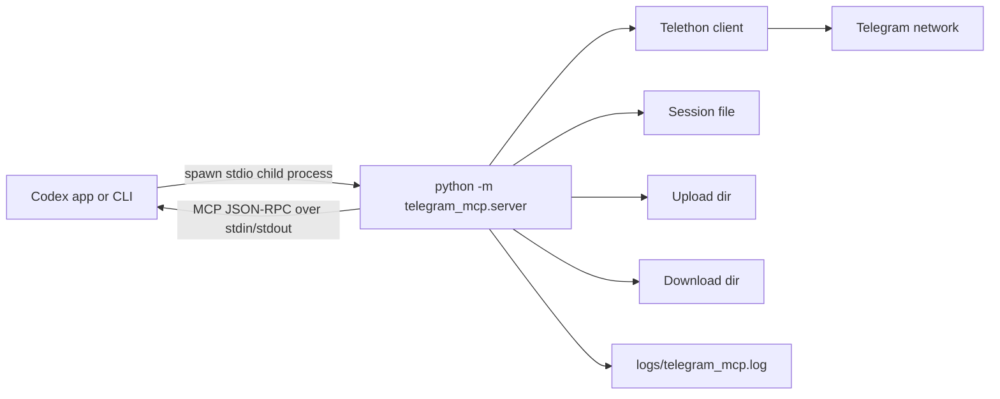
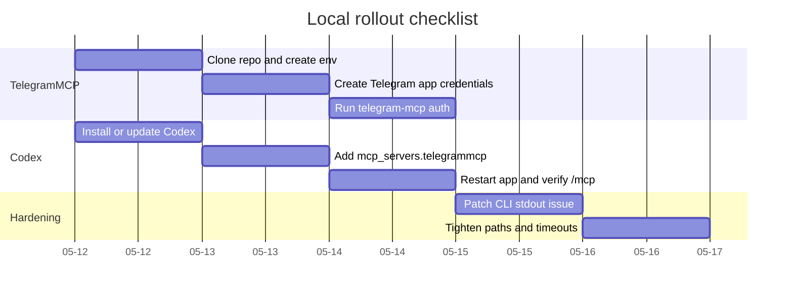

# Local Codex Integration for TelegramMCP

## Executive summary

This repository can be used inside Codex locally **without a protocol rewrite**, because its real MCP server entry point is already a Python `FastMCP` server that runs over **stdio**, which is exactly one of the local transports Codex supports. The main caveat is operational, not architectural: the Typer CLI command `telegram-mcp server` prints a startup banner to standard output before starting `mcp.run()`. Under the MCP stdio transport, non-MCP bytes on `stdout` can break the client-server handshake. The safe launch path for Codex is therefore **`python -m telegram_mcp.server`** or a patched CLI that logs to `stderr` instead of `stdout`. fileciteturn10file0L1-L3 fileciteturn9file0L1-L3 fileciteturn6file0L1-L3 citeturn14search2turn15search8

On the Codex side, the highest-confidence local integration path is a **direct stdio launcher** in `~/.codex/config.toml` or a trusted project-local `.codex/config.toml`. Codex supports stdio servers configured with `command`, `args`, `env`, `env_vars`, and `cwd`, and the same MCP configuration is shared across the Codex app, CLI, and IDE extension. That means you can configure the server once, verify it with `codex mcp list`, and then use it from the app via the `/mcp` status view. citeturn8view0turn7view0turn13view0turn19view0turn23view0

For this specific repo, the practical adapters are: use **absolute paths** for session and storage directories, set a stable `cwd`, pre-authenticate with `telegram-mcp auth`, and increase Codex MCP timeouts above the defaults if your Telegram session startup or media operations are slow. An optional local **Codex plugin** wrapper is also possible, but it adds packaging metadata and marketplace files; it is not required for a working local MCP integration. fileciteturn8file0L1-L3 fileciteturn11file0L1-L3 fileciteturn13file0L1-L3 citeturn8view1turn20view0turn20view2

Assumptions used in this report: no specific Codex version was provided; Linux/macOS is the target; the Codex app is already installed or you are willing to use the Codex CLI to manage the shared config; and the current fetched repo state is the source of truth. Where the docs or code do not fully specify behavior, I call that out explicitly.

## TelegramMCP repo anatomy

The analysis starts from the urlTelegramMCP repositoryhttps://github.com/shaxzodrashid/TelegramMCP. The repo is a Python package requiring **Python 3.12+** and declares dependencies including `mcp`, `telethon`, `python-dotenv`, `pydantic`, `pydantic-settings`, `loguru`, `rich`, and `typer`. It exposes a console script named `telegram-mcp` that points to `telegram_mcp.cli:app`. The README quickstart uses `uv sync` and launches the server with `uv run python -m telegram_mcp.server`. fileciteturn7file0L1-L3 fileciteturn6file0L1-L3

At a module level, the repo is organized around a few clear layers: `src/telegram_mcp/server.py` for MCP tool registration and server startup, `src/telegram_mcp/cli.py` for interactive auth and ops commands, `src/telegram_mcp/service/telegram.py` for the Telethon-backed business logic, `src/telegram_mcp/core/` for configuration, logging, caching, and file safety helpers, and `src/telegram_mcp/models/` for the Pydantic schemas that define chat, message, and media inputs and outputs. The root also includes `.env.example`, `uv.lock`, a `Docs/` folder, and a non-trivial test suite covering CLI, core utilities, chats, media, messages, the Telegram service, and the MCP server surface. fileciteturn6file0L1-L3 fileciteturn8file0L1-L3 fileciteturn10file0L1-L3 fileciteturn12file0L1-L3 fileciteturn14file0L1-L3 fileciteturn15file0L1-L3 fileciteturn16file0L1-L3 fileciteturn20file0L1-L3 fileciteturn21file0L1-L3 fileciteturn22file0L1-L3 fileciteturn24file0L1-L3 fileciteturn25file0L1-L3

From the repo’s README and tests, the MCP surface centers on four practical capabilities: account introspection, chat listing, sending messages or media, and downloading media from message history. The typed models enforce strict input structure (`extra="forbid"`), bounded pagination, and explicit media/message schemas, which is good for an LLM client like Codex because it reduces schema ambiguity and makes tool calling more predictable. fileciteturn6file0L1-L3 fileciteturn14file0L1-L3 fileciteturn15file0L1-L3 fileciteturn16file0L1-L3

The runtime configuration is environment-driven. The fetched config and example env file expose keys such as `API_ID`, `API_HASH`, `SESSION_NAME`, `TELEGRAM_PHONE_NUMBER`, `SERVER_NAME`, `HOST`, `PORT`, `LOG_LEVEL`, `TELEGRAM_DOWNLOAD_DIR`, `TELEGRAM_UPLOAD_DIR`, and upload/download file-size limits. The important nuance is that the **retrieved implementation path is stdio**, not HTTP: the README says “Server is running on stdio transport,” and `server.py` runs `mcp.run()` as the main entry point. I did not retrieve an HTTP MCP server entry point from the live code path, so `HOST` and `PORT` should be treated as **present in configuration but not part of the current local Codex integration path** unless you add a separate HTTP wrapper yourself. fileciteturn8file0L1-L3 fileciteturn6file0L1-L3 fileciteturn9file0L1-L3

A second practical runtime detail is filesystem behavior. By default, downloads and uploads live under relative `storage/...` directories, the logger writes to `logs/telegram_mcp.log` and creates `logs/` with mode `0700`, and the CLI tests verify that `.env` is written with mode `0600`. The file utility layer also restricts uploads to the configured upload/download directories, sanitizes filenames, blocks suspicious extensions like `.exe`, `.sh`, `.js`, `.apk`, archives such as `.zip`, and rejects oversized files. That is useful for safety, but it means Codex-compatible deployment works best when you supply **absolute storage paths** and do not assume arbitrary workspace files can be uploaded unless they reside inside the allowed directories. fileciteturn31file0L1-L3 fileciteturn21file0L1-L3 fileciteturn13file0L1-L3 fileciteturn24file0L1-L3 fileciteturn25file0L1-L3

## How Codex loads external MCPs and plugins locally

According to the entity["organization","OpenAI","ai company"] urlCodex MCP docsturn5view0, Codex supports two MCP transport families locally: **stdio**, where Codex starts a local child process, and **Streamable HTTP**, where Codex talks to a server URL. For stdio servers, the relevant configuration keys are `command`, `args`, `env`, `env_vars`, `cwd`, and optionally `experimental_environment`; for HTTP servers, the relevant keys are `url`, `bearer_token_env_var`, `http_headers`, and `env_http_headers`. The docs also specify MCP server defaults of **10 seconds startup timeout** and **60 seconds per-tool timeout**, with `startup_timeout_sec` and `tool_timeout_sec` available to override them. citeturn8view1turn6view4turn6view5turn6view6turn6view7turn6view8

Codex stores this configuration in `~/.codex/config.toml`, and it can also load project-local `.codex/config.toml` files in **trusted** projects. The Codex CLI, IDE extension, and app all share the same configuration layers, and the app’s settings page explicitly says its MCP settings apply to the CLI and IDE extension because the MCP configuration lives in `config.toml`. In the app, `/mcp` opens the connected-server status view. citeturn7view0turn7view1turn7view3turn19view0turn13view0

That leads to the most important transport conclusion for this repo: for a local stdio server like TelegramMCP, the integration is **process-based IPC over stdin/stdout**, not sockets. The underlying MCP transport spec describes stdio as a client-launched subprocess where the server reads MCP JSON-RPC from `stdin` and emits only valid MCP messages to `stdout`; logging belongs on `stderr`. The MCP auth spec also states that HTTP-based transports should use the protocol’s authorization model, while stdio-based transports should **not** use HTTP OAuth and should instead retrieve credentials from the environment. That aligns almost perfectly with TelegramMCP’s design, which already expects secrets in environment variables and stores a Telethon session locally after interactive login. citeturn14search2turn15search8turn15search2

Codex also has a local plugin system, but plugins are a packaging and discovery layer rather than a different wire protocol. Plugins can bundle skills, apps/connectors, and MCP servers; the required entry point is `.codex-plugin/plugin.json`, and a plugin can point `mcpServers` at an `.mcp.json` file containing either a direct server map or a wrapped `mcp_servers` map. Local plugins can be exposed through a repo marketplace at `$REPO_ROOT/.agents/plugins/marketplace.json` or a personal marketplace at `~/.agents/plugins/marketplace.json`. Codex installs plugins into `~/.codex/plugins/cache/$MARKETPLACE_NAME/$PLUGIN_NAME/$VERSION/`, and local plugins resolve to a cached `local` version. citeturn20view0turn20view1turn20view2

## Compatibility assessment and required changes

### What already fits

At the protocol level, TelegramMCP is already close to an ideal local Codex server. It uses the official Python MCP SDK, starts via `mcp.run()`, and the README’s recommended server command is `python -m telegram_mcp.server`, which is the correct shape for a stdio child process in Codex. No JSON-RPC adapter, proxy, or protocol bridge is required. fileciteturn7file0L1-L3 fileciteturn6file0L1-L3 citeturn8view1turn14search2

### The one change I consider effectively required

The `telegram-mcp server` CLI path is not safe for Codex stdio as retrieved. In `cli.py`, the `server()` command prints a human-facing startup message and then calls `mcp.run()`. Under the MCP stdio spec, that banner can corrupt the transport because the server must not emit non-MCP text on `stdout`. The clean workaround is to configure Codex to launch `python -m telegram_mcp.server` directly. If you want the CLI command to be safe too, patch it so the banner goes to `stderr` or remove it entirely. fileciteturn10file0L1-L3 fileciteturn9file0L1-L3 citeturn14search2turn15search8

```diff
diff --git a/src/telegram_mcp/cli.py b/src/telegram_mcp/cli.py
@@
 @app.command()
 def server():
     """Starts the Telegram MCP server."""
-    console.print("[bold green]Starting Telegram MCP Server...[/bold green]")
+    # IMPORTANT: do not write non-MCP bytes to stdout for stdio clients like Codex
+    print("Starting Telegram MCP Server...", file=sys.stderr)
     mcp.run()
```

If you do not want to patch the repo, simply **do not use that CLI subcommand in Codex**.

### The adapters I recommend even if you do not modify code

First, make paths explicit. This repo’s `.env`, session handling, logs, and default storage folders are all sensitive to the **current working directory**. Codex supports `cwd` for stdio MCP servers, so you should set it deliberately and use **absolute paths** for `SESSION_NAME`, `TELEGRAM_DOWNLOAD_DIR`, and `TELEGRAM_UPLOAD_DIR` to avoid surprises when the app, CLI, or a plugin launches the process from a different directory. fileciteturn8file0L1-L3 fileciteturn10file0L1-L3 fileciteturn13file0L1-L3 citeturn8view1

Second, tune timeouts. Codex’s documented defaults are 10 seconds for server startup and 60 seconds per tool call. That may be enough once a Telegram session is warm, but it can be tight for first-run startup, network hiccups, or media operations. I recommend starting with `startup_timeout_sec = 30` and `tool_timeout_sec = 120`, then tightening later if you want faster failure. citeturn8view1turn6view5turn6view6

Third, align Codex-accessible paths with TelegramMCP’s file safety rules. The repo intentionally allows uploads only from the configured upload/download directories and blocks suspicious or unsupported media sources such as direct URLs or blocked extensions. If you want Codex to send a file from your workspace, either point `TELEGRAM_UPLOAD_DIR` at a dedicated safe folder under that workspace or copy the file there first. fileciteturn13file0L1-L3 fileciteturn25file0L1-L3

### Optional plugin packaging

If you want TelegramMCP to appear through Codex’s plugin system rather than just as a raw MCP server, you can wrap it in a tiny local plugin. That wrapper does **not** change the TelegramMCP runtime; it only adds Codex discovery metadata and a local marketplace entry. This is useful if you want a reusable packaged install or team sharability. citeturn20view0turn20view1turn20view2

Minimal plugin files:

```json
// telegrammcp-plugin/.codex-plugin/plugin.json
{
  "name": "telegrammcp-plugin",
  "version": "0.1.0",
  "description": "Bundle TelegramMCP for Codex.",
  "mcpServers": "./.mcp.json"
}
```

```json
// telegrammcp-plugin/.mcp.json
{
  "mcp_servers": {
    "telegrammcp": {
      "command": "/absolute/path/to/TelegramMCP/.venv/bin/python",
      "args": ["-m", "telegram_mcp.server"],
      "cwd": "/absolute/path/to/TelegramMCP"
    }
  }
}
```

## Local setup and configuration

The comparison below is synthesized from the fetched TelegramMCP repo, the Codex MCP/config/plugin docs, and the Telegram API registration docs. fileciteturn6file0L1-L3 fileciteturn7file0L1-L3 fileciteturn8file0L1-L3 citeturn8view1turn20view0turn20view2turn24search0turn23view0

| Component | Required files | Primary commands | Ports / IPC | Required env vars | Important optional env vars |
|---|---|---|---|---|---|
| TelegramMCP server | `pyproject.toml`, `.env` copied from `.env.example`, Python venv or `uv` env, optional Telethon session file | `python -m telegram_mcp.server` or `uv run python -m telegram_mcp.server`; `telegram-mcp auth` before first use | **stdio** to Codex; outbound network to Telegram; no local MCP port required | `API_ID`, `API_HASH` | `SESSION_NAME`, `TELEGRAM_PHONE_NUMBER`, `TELEGRAM_DOWNLOAD_DIR`, `TELEGRAM_UPLOAD_DIR`, `TELEGRAM_DOWNLOAD_MAX_FILE_SIZE_MB`, `TELEGRAM_UPLOAD_MAX_FILE_SIZE_MB`, `LOG_LEVEL` |
| Codex app / CLI | `~/.codex/config.toml` or trusted `.codex/config.toml` | `codex`, `codex --login`, `codex mcp list` | Launches stdio child process for local MCP; HTTP only if you configure `url`; OAuth callback port only for HTTP OAuth servers | none for stdio-only MCP beyond whatever you forward to the server | `mcp_servers.<id>.cwd`, `env`, `env_vars`, `startup_timeout_sec`, `tool_timeout_sec`, `required`, `enabled_tools`, `disabled_tools`; for HTTP: `bearer_token_env_var`, `http_headers`, `env_http_headers`, `mcp_oauth_callback_port` |
| Optional local plugin wrapper | `.codex-plugin/plugin.json`, `.mcp.json`, marketplace file | `codex plugin marketplace add ./local-marketplace-root` or manual marketplace files | Same as the server declared inside `.mcp.json`; plugin itself adds no new transport | none by itself | Marketplace metadata and install policy |

### Integration flow



### TelegramMCP installation

The repo already documents a `uv`-based quickstart, but for maximum portability on Linux/macOS a plain virtualenv works fine too. The key requirement from the repo metadata is Python 3.12+. fileciteturn6file0L1-L3 fileciteturn7file0L1-L3

```bash
# Choose one path: venv/pip or uv

# Option A: venv/pip
git clone https://github.com/shaxzodrashid/TelegramMCP.git
cd TelegramMCP
python3.12 -m venv .venv
source .venv/bin/activate
python -m pip install --upgrade pip
pip install -e .

# Option B: uv
git clone https://github.com/shaxzodrashid/TelegramMCP.git
cd TelegramMCP
uv sync
```

Create Telegram API credentials through the urlTelegram API app registration docsturn24search0: sign in with an official Telegram app, log in to `my.telegram.org`, open “API development tools,” and obtain `api_id` and `api_hash`. Telegram’s own docs emphasize that you should use your own app credentials and comply with the API terms. citeturn24search0turn24search6

Then create a concrete `.env` using absolute paths:

```bash
cp .env.example .env
chmod 600 .env
```

Example `.env` for Codex-friendly local use:

```dotenv
API_ID=12345678
API_HASH=your_real_api_hash
SESSION_NAME=/absolute/path/to/TelegramMCP/.state/telegram_mcp_session
TELEGRAM_PHONE_NUMBER=+15551234567

SERVER_NAME=telegrammcp
LOG_LEVEL=INFO

TELEGRAM_DOWNLOAD_DIR=/absolute/path/to/TelegramMCP/.state/downloads
TELEGRAM_UPLOAD_DIR=/absolute/path/to/TelegramMCP/.state/uploads
TELEGRAM_DOWNLOAD_MAX_FILE_SIZE_MB=20
TELEGRAM_UPLOAD_MAX_FILE_SIZE_MB=50
```

Authenticate once **before** Codex tries to use the MCP server. The repo’s CLI implements an interactive auth flow and separate logout/status commands. fileciteturn10file0L1-L3 fileciteturn20file0L1-L3

```bash
# venv path
source .venv/bin/activate

# first login
telegram-mcp auth

# optional sanity check
telegram-mcp status
```

### Codex local setup

The easiest verified way to install the local Codex client is either `npm i -g @openai/codex` or `brew install --cask codex`. The current maintained client is the Rust implementation, and the open-source README explicitly says `codex mcp` is the command family for add/list/get/remove MCP server launchers defined in `config.toml`. If you are using the app rather than the CLI as your main surface, that is still fine because the app and CLI share the same configuration. citeturn23view0turn19view0turn7view0

```bash
# choose one
npm i -g @openai/codex
# or
brew install --cask codex

# authenticate
codex --login
```

### Codex configuration for TelegramMCP

For this repo, I recommend configuring Codex as a **stdio** MCP server with an explicit interpreter path and working directory. Do **not** use `telegram-mcp server` here unless you apply the stdout patch.

Add this to `~/.codex/config.toml` or to a trusted project-local `.codex/config.toml`:

```toml
[mcp_servers.telegrammcp]
command = "/absolute/path/to/TelegramMCP/.venv/bin/python"
args = ["-m", "telegram_mcp.server"]
cwd = "/absolute/path/to/TelegramMCP"
startup_timeout_sec = 30
tool_timeout_sec = 120
required = false

[mcp_servers.telegrammcp.env]
API_ID = "12345678"
API_HASH = "your_real_api_hash"
SESSION_NAME = "/absolute/path/to/TelegramMCP/.state/telegram_mcp_session"
TELEGRAM_PHONE_NUMBER = "+15551234567"
SERVER_NAME = "telegrammcp"
LOG_LEVEL = "INFO"
TELEGRAM_DOWNLOAD_DIR = "/absolute/path/to/TelegramMCP/.state/downloads"
TELEGRAM_UPLOAD_DIR = "/absolute/path/to/TelegramMCP/.state/uploads"
TELEGRAM_DOWNLOAD_MAX_FILE_SIZE_MB = "20"
TELEGRAM_UPLOAD_MAX_FILE_SIZE_MB = "50"
```

If you prefer not to store secrets directly in `config.toml`, use Codex’s `env_vars` mechanism and keep the real values in your shell environment instead. The Codex docs explicitly support that pattern for stdio MCP servers. citeturn8view1turn6view7

```toml
[mcp_servers.telegrammcp]
command = "/absolute/path/to/TelegramMCP/.venv/bin/python"
args = ["-m", "telegram_mcp.server"]
cwd = "/absolute/path/to/TelegramMCP"
env_vars = ["API_ID", "API_HASH", "SESSION_NAME", "TELEGRAM_PHONE_NUMBER"]

[mcp_servers.telegrammcp.env]
SERVER_NAME = "telegrammcp"
LOG_LEVEL = "INFO"
TELEGRAM_DOWNLOAD_DIR = "/absolute/path/to/TelegramMCP/.state/downloads"
TELEGRAM_UPLOAD_DIR = "/absolute/path/to/TelegramMCP/.state/uploads"
```

### Optional local plugin packaging

If you want the app to discover TelegramMCP through a local plugin market instead of raw MCP settings, create a plugin folder, add it to a personal marketplace, then restart Codex. The official plugin docs support personal marketplaces in `~/.agents/plugins/marketplace.json` with plugin content stored under `~/.codex/plugins/`. citeturn20view2turn20view0

```bash
mkdir -p ~/.codex/plugins/telegrammcp-plugin/.codex-plugin
mkdir -p ~/.agents/plugins
```

```json
// ~/.codex/plugins/telegrammcp-plugin/.codex-plugin/plugin.json
{
  "name": "telegrammcp-plugin",
  "version": "0.1.0",
  "description": "Local Telegram MCP for Codex",
  "mcpServers": "./.mcp.json"
}
```

```json
// ~/.codex/plugins/telegrammcp-plugin/.mcp.json
{
  "mcp_servers": {
    "telegrammcp": {
      "command": "/absolute/path/to/TelegramMCP/.venv/bin/python",
      "args": ["-m", "telegram_mcp.server"],
      "cwd": "/absolute/path/to/TelegramMCP"
    }
  }
}
```

```json
// ~/.agents/plugins/marketplace.json
{
  "name": "local-plugins",
  "plugins": [
    {
      "name": "telegrammcp-plugin",
      "source": {
        "source": "local",
        "path": "./.codex/plugins/telegrammcp-plugin"
      },
      "policy": {
        "installation": "AVAILABLE",
        "authentication": "ON_INSTALL"
      },
      "category": "Productivity"
    }
  ]
}
```

### Timeline checklist



## Verification, troubleshooting, and security

Verification should happen in three layers. First, verify the Telegram side independently by running `telegram-mcp status` after authentication. Second, verify Codex’s launcher configuration with `codex mcp list` and then restart the app. Third, inside the Codex app use `/mcp` to confirm the server is connected, then prompt Codex to use the Telegram tools for something benign such as account info or chat listing. The app commands docs explicitly document `/mcp`, and the Codex MCP docs explicitly document `codex mcp list` and shared config behavior. fileciteturn10file0L1-L3 citeturn8view0turn13view0turn23view0

The most common failure mode for this repo in Codex is a broken stdio handshake caused by the CLI startup banner. If Codex shows an immediate MCP initialization failure, switch the launcher from `telegram-mcp server` to `python -m telegram_mcp.server`, or patch the CLI to log on `stderr`. A second common failure is “not logged in” behavior when the server process cannot find the expected Telethon session file because your `cwd` changed or `SESSION_NAME` is relative. Absolute `SESSION_NAME` plus explicit `cwd` solves that. fileciteturn10file0L1-L3 fileciteturn9file0L1-L3 fileciteturn20file0L1-L3 citeturn14search2turn15search8

A third class of failures is Telegram credential or login trouble. If you see `API_ID_INVALID`, `PHONE_NUMBER_INVALID`, or similar login-related failures, go back to the official Telegram app-registration flow and verify that the values in `.env` match the app you created. Telegram’s own docs are explicit that `api_id` and `api_hash` come from `my.telegram.org` and are required for user authorization. citeturn24search0turn24search4

File-transfer failures are usually the repo working as designed, not a Codex bug. The tests and utility layer show intentional rejections for empty message requests, media URLs, unsafe upload paths, blocked extensions, missing files, oversized files, and suspicious downloads unless explicitly allowed. If Codex needs to send a file, copy that file into the configured upload directory first and make sure the path is readable by the server process. fileciteturn25file0L1-L3 fileciteturn24file0L1-L3 fileciteturn13file0L1-L3

From a security standpoint, the repo has a decent baseline: `.env` is tested with `0600` permissions, logs are written under a `0700` directory, file names are sanitized, path traversal is mitigated, and suspicious file types are blocked by default. Preserve those controls when integrating with Codex. Keep secrets out of Git, prefer environment forwarding over hardcoded tokens where practical, and keep upload/download directories narrow and purpose-built. For Codex itself, stdio MCP servers should use environment-based credentials, while HTTP MCP servers should use bearer-token env variables or OAuth rather than hardcoded credentials inside the config. fileciteturn21file0L1-L3 fileciteturn31file0L1-L3 fileciteturn13file0L1-L3 citeturn15search8turn8view1turn19view0

## Open questions and limitations

The repo state I retrieved did **not** expose an HTTP MCP server entry point, so this report treats TelegramMCP as a **stdio-only local server** for now. `HOST` and `PORT` exist in config, but I did not find evidence in the retrieved runtime path that Codex should use them for current local integration. fileciteturn8file0L1-L3 fileciteturn9file0L1-L3

The Codex docs are very clear about how the app, CLI, and IDE share `config.toml`, and they clearly document local plugins and MCP launcher configuration. What they do **not** make fully explicit in the retrieved sources is whether Codex’s command sandbox policies also constrain spawned stdio MCP subprocesses in exactly the same way. For that reason, if you are relying on strict filesystem isolation, you should validate behavior on your target machine rather than assume parity. citeturn7view0turn19view0turn16view1

The net result is still straightforward: **configure TelegramMCP as a stdio child process, launch `python -m telegram_mcp.server`, set stable absolute paths, authenticate once up front, and only add plugin packaging if you want Codex-native discovery/distribution rather than direct MCP configuration.** fileciteturn6file0L1-L3 fileciteturn10file0L1-L3 citeturn8view0turn20view2